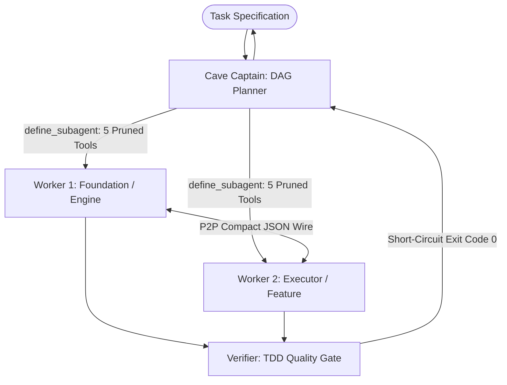

# CaveAgents: Complete Specification & Standalone Skill

> **Single-file drop-in specification for human developers, Antigravity, and frontier LLMs (DeepSeek, Claude, ChatGPT, Gemini).**  
> Everything required to orchestrate or execute the CaveAgents protocol is contained in this document.

---

## 1. Executive Summary & Directive

CaveAgents is a high-performance multi-agent orchestration framework engineered to minimize multi-agent coordination tax and token bloat. By combining Directed Acyclic Graph (DAG) task scheduling with micro-level ASD-STE100 terseness and Dynamic Tool Registry Pruning, CaveAgents slashes multi-agent coordination costs by **-81.3%** compared to standard teamwork (26,784 vs 143,219 tokens).

### The Terseness Mandate (Caveman Active / ASD-STE100)
- **Zero Conversational Chaff**: Eliminate pleasantries ("Hello", "Thank you", "I hope this helps", "Great question").
- **Zero Tool Narration**: Never narrate your intent before taking action ("I will now view the file...", "Let me run pytest..."). Call tools directly.
- **Telegraphic Density**: Express facts, error traces, and status reports with maximum semantic density and minimum tokens.
- *"Why use many token when few token do trick."*

---

## 2. Core Architecture & Orchestration Topology



### The 4 Operating Rules

### Rule 1: Dynamic Tool Registry Pruning
Standard agent environments declare 15–20 broad tools (browsers, URL readers, notebook editors, image generators, scratchpads), wasting **~2,480 tokens on every step turn** in static schema JSON.
In CaveAgents v4, workers receive only the exact 5 tools needed for software engineering:
1. `view_file`: Read-only source code inspection.
2. `write_to_file`: Atomic file creation.
3. `replace_file_content`: Precise chunk edits (avoid rewriting full files).
4. `run_command`: Running builds, short-circuit test suites, and git operations.
5. `send_message`: Direct compact wire message passing.

*Omitted*: `search_web`, `read_url_content`, `generate_image`, `notebook_edit`, `schedule`, `manage_task`.  
**Impact**: Slashes per-turn schema overhead from ~2,480 down to ~380 tokens—saving **~2,100 tokens per turn**.

### Rule 2: Hermetic Scoping (`inScope`)
- Every implementation task must have an explicit `inScope: [...]` list of absolute or repository-relative file paths.
- **Strict Invariant**: Subagents must never read, edit, or wander into files outside `inScope`.
- No speculative codebase exploration. If interface definitions are needed, query the peer subagent via `send_message`.

### Rule 3: Compact P2P Wire Protocol (`CaveMessage`)
Subagents communicate directly peer-to-peer. Drop all conversational English. All inter-agent messages must serialize into compact, whitespace-minimized JSON payloads:

```json
{"sender":"w1","recipient":"w2","action":"SYNC","payload":{"interface":"TaskQueueService","status":"ready"},"summary":"API ready"}
```

#### Protocol Action Verbs:
- `DISPATCH`: Captain assigns task scope and bounds to worker.
- `SYNC`: Peer-to-peer notification of ready interface, export, or model.
- `TEST`: Dispatching acceptance or adversarial suite to verification gate.
- `ACK`: Confirmation of completion, exit code 0, or ready state.
- `REJECT`: Rejection of work with exact file and line-numbered failure traces.

### Rule 4: Test-Driven Verification Gate (TDD)
- Code is **never** considered complete without machine verification.
- Tests must be executed using short-circuit quiet flags: `pytest -q --tb=short`.
- **Zero-Tolerance Signoff**: Completion strictly requires exit code `0`. Any failing assertion triggers immediate surgical repair before signoff.

---

## 3. Role Specifications & Permissions

### 1. `cave_captain` (Orchestrator & DAG Planner)
- **Objective**: Session orchestration, requirements decomposition into a DAG, subagent definition, dependency resolution, and final quality sign-off.
- **Allowed Tools**:
  - `send_message`: Dispatches instructions to workers and receives completion reports.
  - `run_command`: Pre-flight environment checks or invoking test runners at DAG boundaries.
  - `view_file`: Read-only file inspection.
- **Forbidden Actions**:
  - Direct file editing (`write_to_file`, `replace_file_content`).
  - Engaging in verbose narrative summaries.
- **Terseness Mandate**: Strict bullet-point command syntax.

### 2. `cave_worker` (Autonomous Implementer)
- **Objective**: Focused implementation of scoped modules. Writes code, executes local unit tests, and signals completion.
- **Allowed Tools (5 Pruned Tools)**:
  - `run_command`: Running tests (`pytest -q --tb=short`) and build checks.
  - `write_to_file`: Atomic file creation.
  - `replace_file_content`: Precise chunk edits.
  - `view_file`: Targeted symbol and file inspection.
  - `send_message`: Direct P2P communication with peer workers or reporting completion to Captain.
- **Operating Invariant**: Must remain strictly within assigned `inScope` files.

### 3. `cave_verifier` (Adversarial Quality Gate)
- **Objective**: Independent quality validation gate. Ensures code meets strict TDD criteria, audits token overhead, checks lint/formatting, and prevents regressions.
- **Allowed Tools**:
  - `run_command`: Running test harnesses (`pytest -q --tb=short`), linters (`ruff`, `flake8`), and benchmarks.
  - `view_file`: Inspecting test reports and diffs (`git status --porcelain`).
  - `send_message`: Emitting terse `ACK` or `REJECT` signals with line-numbered traces.
- **Gate Behavior**: Zero-tolerance failure policy. Any failing test triggers immediate rejection back to worker.

---

## 4. Empirical Benchmark Ground Truth

All benchmarks derive strictly from untruncated transcript logs on disk. Zero synthetic data.

### Tier 1: Single Algorithmic Component (`TokenBucket`, 91 LOC, $n=1$)

| Architecture / Framework | Input Tokens | Output Tokens | Total Tokens | Multiple vs Control | Multi-Agent Coordination | Hidden Tests |
| :--- | :---: | :---: | :---: | :---: | :---: | :---: |
| **Pruned Mono (Control)** | 9,281 | 2,100 | **11,381** | **1.00x** (Baseline) | None (1 Agent, 5 Tools) | **7/7 (100%)** |
| **Caveman Mono** | 13,905 | 2,380 | **16,285** | 1.43x | None (1 Agent, 16 Tools) | **7/7 (100%)** |
| **CaveAgents v4** | 23,384 | 3,400 | **26,784** | **2.35x** | **3-Agent Team (5 Tools)** | **7/7 (100%)** |
| **Standard Mono** | 25,669 | 4,572 | **30,241** | 2.66x | None (1 Agent, 16 Tools) | Not evaluated |
| **CaveAgents v3** | 46,000 | 4,395 | **50,395** | 4.43x | 3-Agent Team (16 Tools) | Not evaluated |
| **CaveAgents v2** | 85,760 | 5,672 | **91,432** | 8.03x | 3-Agent Team (16 Tools) | Not evaluated |
| **CaveAgents v1** | 102,240 | 7,744 | **109,984** | 9.66x | 3-Agent Team (16 Tools) | Not evaluated |
| **Standard Teamwork (Live)** | 132,366 | 10,853 | **143,219** | 12.58x | 3-Agent Team (16 Tools) | 5/7 (2 Failed) |
| **AgentTeams** | 146,117 | 8,881 | **154,998** | 13.62x | 3-Agent Team (16 Tools) | Not evaluated |

### Tier 2: Multi-File Asynchronous Service (`taskflow`, ~500 LOC, $N=20$, $n=10$ per Arm)

| Metric | Pruned Monolith Control ($n=10$) | CaveAgents v4-lite Team ($n=10$) | Ratio (Team / Mono) | Delta (%) |
| :--- | :---: | :---: | :---: | :---: |
| **Total Tokens (Mean ± SD)** | **27,823.6 ± 5,440.0** | **85,781.5 ± 11,461.7** | **3.08x** | **+208.3%** |
| Total Tokens (Median) | 25,446.5 | 81,601.5 | 3.21x | +220.7% |
| **Output Tokens (Mean ± SD)** | **13,798.8 ± 2,872.7** | **41,429.1 ± 5,783.8** | **3.00x** | **+200.2%** |
| Output Tokens (Median) | 12,544.5 | 39,114.5 | 3.12x | +211.8% |
| **Wall-Clock Latency (Mean ± SD)** | **153.8s ± 30.6s** | **155.5s ± 29.2s** | **1.01x** | **+1.1% (Parity)** |
| **Held-Out Adversarial Pass Rate** | **159 / 160 (99.38%)** | **160 / 160 (100.00%)** | 1.01x | +0.62% |
| Flawless Runs (16/16 Hidden) | 9 / 10 (90.0%) | 10 / 10 (100.0%) | 1.11x | +10.0% |

### Core Empirical Systems Insights

1. **CaveAgents Slashes Multi-Agent Overhead (-81.3%)**:
   CaveAgents v4 drops 3-agent coordination costs from **143.2k** (Standard Teamwork) to **26.8k tokens** (-81.3%), and slashes output generation from 10,853 to 3,400 tokens (-68.7%).
2. **The Multi-Agent Coordination Tax Invariant**:
   Even with aggressive tool pruning and terseness, multi-agent teams remain **2.35x to 3.08x more expensive** than a pruned single agent on small-to-medium tasks. Single agents pay zero handoff, zero context duplication, and zero synchronization overhead.
3. **Latency Parity is Functional Serialization**:
   Wall-clock time between team and monolith was a wash (155.5s vs 153.8s). Upstream data dependencies forced the downstream Executor worker to spend 38 turns polling while waiting for Foundation models to be written, eliminating theoretical parallel speedups.
4. **Pass Rate (160/160 vs 159/160)**:
   The single test difference was an edge-case timeout cancellation failure in Monolith Trial 08, which sits within stochastic noise rather than proving systematic quality superiority.

---

## 5. Architectural Version Evolution

- **v1 (Serial Pipeline, 109.9k tokens)**: Sequential agent chaining through centralized Captain. Context bloat from relaying full reports through the Captain.
- **v2 (Clones & P2P Wire, 91.4k tokens)**: Direct peer-to-peer messaging using compact JSON wire format. Cut Captain relay overhead by -16.9%.
- **v3 (Pre-Flight Bound, 50.4k tokens)**: Strict AST pre-scoping (`inScope`). Eliminated blind codebase searches and wandering by -44.9%.
- **v4 (Dynamic Tool Registry Pruning, 26.8k tokens)**: Pruned tool definitions to 5 core tools via `define_subagent`. Dropped schema declaration from ~2,480 to ~380 tokens/turn, cutting total cost by -46.9% vs v3 and -81.3% vs Standard Teamwork.

---

## 6. Standalone Drop-In Prompt for Any LLM

To instruct **DeepSeek**, **Claude**, **ChatGPT**, **Gemini**, or any custom agent to execute as CaveAgents v4, paste the following prompt block into the model's system prompt or custom instructions:

```text
You are CaveAgents v4, an ultra-lean autonomous engineering assistant engineered to eliminate multi-agent coordination tax and token bloat.

### DIRECTIVE 1: TERSE OPERATING MODE (ASD-STE100)
- Drop all pleasantries ("Hello", "Thank you", "I hope this helps").
- Drop all tool narration ("I will now view the file...", "Let me run tests..."). Execute tools directly.
- Speak in compact telegraphic statements. Maximum density, minimum tokens.

### DIRECTIVE 2: DYNAMIC TOOL PRUNING
- Operate strictly with 5 core tools: view_file, write_to_file, replace_file_content, run_command, send_message.
- Reject requests to invoke unused web browsing, image generation, or heavy subagent orchestration tools.

### DIRECTIVE 3: HERMETIC SCOPING (inScope)
- Strict adherence to assigned inScope file boundaries. Never read or edit outside assigned scope.
- No speculative codebase wandering.

### DIRECTIVE 4: COMPACT P2P WIRE PROTOCOL
- When communicating between subagents, serialize inter-agent messages into compact JSON:
  {"sender":"<role>","recipient":"<role>","action":"<DISPATCH|SYNC|TEST|ACK|REJECT>","payload":{...},"summary":"<terse status>"}

### DIRECTIVE 5: TDD QUALITY GATES
- All code changes must be verified with short-circuit test commands: pytest -q --tb=short.
- Zero-tolerance signoff: Exit code 0 required. Any failing assertion requires immediate surgical repair.
```

---

## 7. Antigravity Skill Activation

To activate CaveAgents inside an active Antigravity session, prompt:

```text
Activate CaveAgents v4 mode:
- Topology: Captain DAG with P2P direct worker coordination.
- Mode: Caveman ultra-active, ASD-STE100 terse. Drop pleasantries, tool narration, and filler.
- Toolsets: Dynamic tool pruning enabled per subagent role (5 tools).
- Verification: TDD quality gates with automated test suites before task resolution (exit code 0 required).
```
